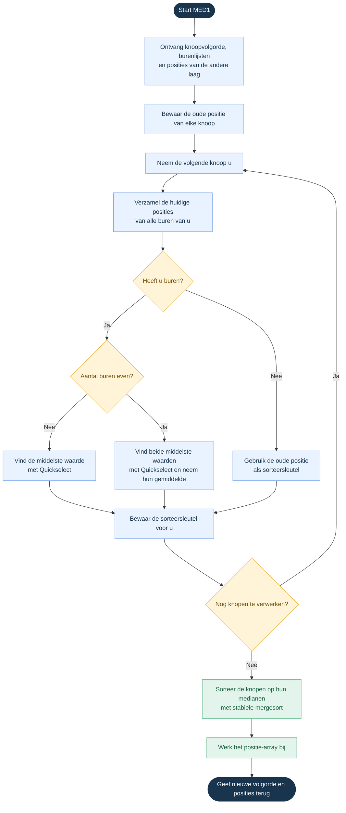
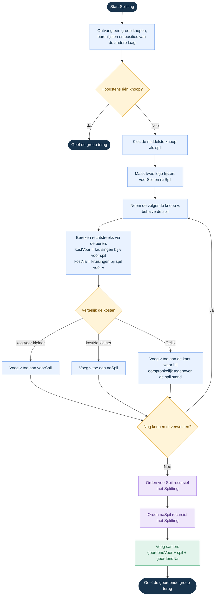

# GegevensstructurenProject
Code voor het project van Gegevensstructuren en algoritmen X0A45A 2026-2027. De gekozen heuristieken zijn MED1 en SP, en de gekozen metaheuristiek is SA.

# MED1

Verloop van 1 ordeningsstap:

- Zet de rechterlaag vast.
- Bekijk voor elke linkerknoop op welke posities zijn buren rechts staan.
- Sorteer die buurposities en bepaal de mediaan.
- Orden daarna de linkerknopen volgens oplopende mediaan.

Voorbeeld:

| Knoop | Buurposities | Mediaan |
|-------|--------------|---------|
| A     | 1, 2, 7      | 2       |
| B     | 3, 5, 6      | 5       |
| C     | 2, 3, 4      | 3       |

→ De nieuwe volgorde is: **A C B**

Na het ordenen van links kun je links vasthouden en rechts ordenen.

**Bij gelijke medianen: We kiezen hier om de volgorde niet aan te passen.
**Bij een even aantal buurposities: Bereken het gemiddelde tussen de 2 middelste buurposities.

# Splitting – SP

Kernidee: kies een spil en verdeel de andere knopen volgens hun kruisingskosten.

K(i, j) = aantal kruisingen tussen verbindingen van linkerknopen i en j, wanneer i voor j staat.

In het algemeen: K(i, j) ≠ K(j, i).

## Splittingprincipe

Kies in de te ordenen groep een spil u. Voor elke andere knoop v vergelijk je de 2 mogelijkheden:

- v voor u: K(v, u)
- v na u: K(u, v)

Plaats v aan de kant met de kleinste bijdrage. Orden daarna de groep voor u en de groep na u elk opnieuw met hetzelfde splittingprincipe.

Voorbeeld:

| Knoop v | K(v, u) | K(u, v) | Beslissing |
|---------|---------|---------|------------|
| A       | 0       | 2       | A voor u   |
| B       | 2       | 0       | B na u     |
| C       | 1       | 1       | Gelijke kosten: laat de knoop staan waar hij oorspronkelijk stond. |

# Simulated Annealing – SA

Kernidee: accepteer soms een slechtere oplossing; verminder die kans tijdens het zoeken.

>Hoe kies je de random aanpassing: Kies willekeurig de linker of rechterlaag en kies daarin willekeurig 2 knopen en verwissel hun positie. Accepteer of verwerp volgens SA-regels.

Een lokale zoekmethode die alleen verbeteringen accepteert, kan vastlopen. SA laat soms een stap met meer kruisingen toe.

- s = huidige oplossing
- s′ = kandidaat
- Δ = C(s′) − C(s) (kostenverschil)

Acceptatieregel:

- Δ ≤ 0: accepteer de kandidaat.
- Δ > 0: accepteer de kandidaat met kans e^(−Δ/T), met T > 0.

## Voorbeeld

De huidige oplossing heeft 20 kruisingen. De kandidaat heeft er 23.

Δ = 3. Bij T = 1,0 is de acceptatiekans ongeveer 0,050.

Trek je een uniform willekeurig getal tussen 0 en 1, dan accepteer je wanneer dat kleiner is dan die kans.

Een kandidaat met 18 kruisingen wordt altijd geaccepteerd.

## Afkoelschema

T daalt volgens een afkoelschema, bijvoorbeeld:

T_nieuw = α · T, met 0 < α < 1.

## Huidige en beste oplossing

De huidige oplossing en de beste oplossing zijn verschillend. De huidige oplossing kan verslechteren.

Bewaar daarnaast de beste oplossing die tijdens het zoeken gevonden is. Die is het uiteindelijke resultaat.

