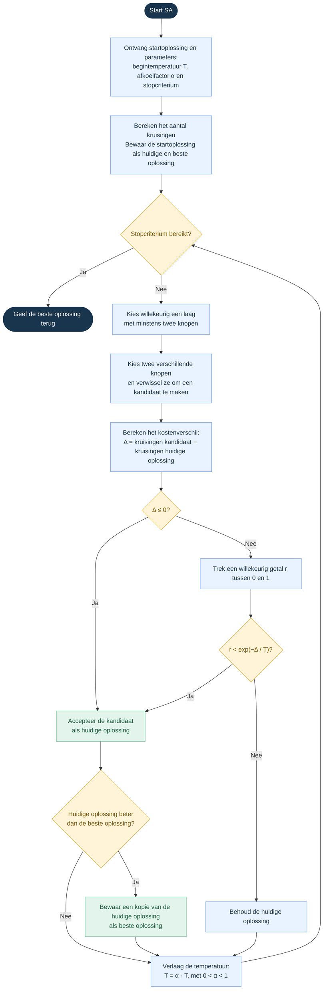
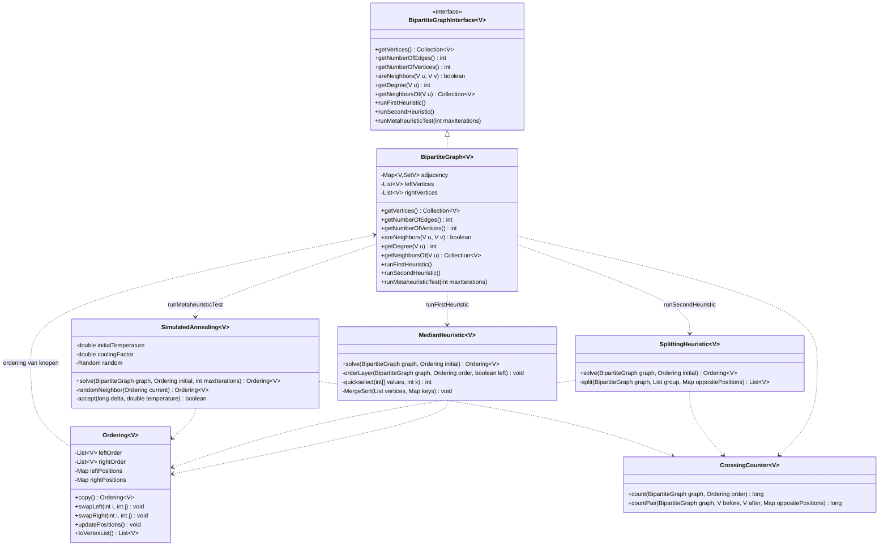

# GegevensstructurenProject
Code voor het project van Gegevensstructuren en algoritmen X0A45A 2026-2027. De gekozen heuristieken zijn MED1 en SP, en de gekozen metaheuristiek is SA.


# MED1

Verloop van 1 ordeningsstap:

- Zet de rechterlaag vast.
- Bekijk voor elke linkerknoop op welke posities zijn buren rechts staan.
- Sorteer die buurposities en bepaal de mediaan.
- Orden daarna de linkerknopen volgens oplopende mediaan.

Voorbeeld:

| Knoop | Buurposities | Mediaan |
|-------|--------------|---------|
| A     | 1, 2, 7      | 2       |
| B     | 3, 5, 6      | 5       |
| C     | 2, 3, 4      | 3       |

→ De nieuwe volgorde is: **A C B**

Na het ordenen van links kun je links vasthouden en rechts ordenen.

**Bij gelijke medianen: We kiezen hier om de volgorde niet aan te passen.
**Bij een even aantal buurposities: Bereken het gemiddelde tussen de 2 middelste buurposities.


# Splitting – SP

Kernidee: kies een spil en verdeel de andere knopen volgens hun kruisingskosten.

K(i, j) = aantal kruisingen tussen verbindingen van linkerknopen i en j, wanneer i voor j staat.

In het algemeen: K(i, j) ≠ K(j, i).

## Splittingprincipe

Kies in de te ordenen groep een spil u. Voor elke andere knoop v vergelijk je de 2 mogelijkheden:

- v voor u: K(v, u)
- v na u: K(u, v)

Plaats v aan de kant met de kleinste bijdrage. Orden daarna de groep voor u en de groep na u elk opnieuw met hetzelfde splittingprincipe.

Voorbeeld:

| Knoop v | K(v, u) | K(u, v) | Beslissing |
|---------|---------|---------|------------|
| A       | 0       | 2       | A voor u   |
| B       | 2       | 0       | B na u     |
| C       | 1       | 1       | Gelijke kosten: laat de knoop staan waar hij oorspronkelijk stond. |


# Simulated Annealing – SA

Kernidee: accepteer soms een slechtere oplossing; verminder die kans tijdens het zoeken.

>Hoe kies je de random aanpassing: Kies willekeurig de linker of rechterlaag en kies daarin willekeurig 2 knopen en verwissel hun positie. Accepteer of verwerp volgens SA-regels.

Een lokale zoekmethode die alleen verbeteringen accepteert, kan vastlopen. SA laat soms een stap met meer kruisingen toe.

- s = huidige oplossing
- s′ = kandidaat
- Δ = C(s′) − C(s) (kostenverschil)

Acceptatieregel:

- Δ ≤ 0: accepteer de kandidaat.
- Δ > 0: accepteer de kandidaat met kans e^(−Δ/T), met T > 0.

## Voorbeeld

De huidige oplossing heeft 20 kruisingen. De kandidaat heeft er 23.

Δ = 3. Bij T = 1,0 is de acceptatiekans ongeveer 0,050.

Trek je een uniform willekeurig getal tussen 0 en 1, dan accepteer je wanneer dat kleiner is dan die kans.

Een kandidaat met 18 kruisingen wordt altijd geaccepteerd.

## Afkoelschema

T daalt volgens een afkoelschema, bijvoorbeeld:

T_nieuw = α · T, met 0 < α < 1.

## Huidige en beste oplossing

De huidige oplossing en de beste oplossing zijn verschillend. De huidige oplossing kan verslechteren.

Bewaar daarnaast de beste oplossing die tijdens het zoeken gevonden is. Die is het uiteindelijke resultaat.





# UML diagram:



## Gekozen datastructuren

### `Map<V, Set<V>> adjacency` - de verbindingen van de graaf

Deze map stelt een **adjacentielijst** voor: bij elke knoop wordt bijgehouden welke buren hij heeft.

Bijvoorbeeld:

- `A → {1, 3}`
- `B → {2, 3}`
- `C → {1}`

### `List<V> leftVertices` en `rightVertices` - de twee partities

De twee lijsten bewaren expliciet welke knopen links en rechts staan:

- `leftVertices  = [A, B, C]`
- `rightVertices = [1, 2, 3]`

### `Ordering` - lijsten en positiemaps

```java
List<V> leftOrder;
List<V> rightOrder;

Map<V, Integer> leftPositions;
Map<V, Integer> rightPositions;
```

De **lijsten** beantwoorden: “Welke knoop staat op positie i?”  
De **maps** beantwoorden: “Op welke positie staat knoop v?”

Bijvoorbeeld:

- `leftOrder     = [C, A, B]`
- `leftPositions = {C → 0, A → 1, B → 2}`

Zonder positiemap moet je een lijst doorzoeken om de positie van een knoop te vinden: **O(n)**  
Het nadeel is dat de lijsten en maps **consistent moeten blijven**.

### `MedianHeuristic` - arrays en sorteersleutels

`quickselect(int[] values, int k)` gebruikt een **array van gehele getallen** voor de posities van de buren

Bijvoorbeeld:

- `Buurposities van A = [1, 4, 6]`
- `Mediaan           = 4`

> Bij een lijst met even aantal getallen zal je 2 keer quicksort moeten uitvoeren en het gemiddelde van de 2 berekenen

De **`Map keys`** koppelt elke knoop aan zijn berekende sorteersleutel. `MergeSort` sorteert de knopen op die sleutel in **O(n log n)**. We gebruiken **merge sort** zodat knopen met dezelfde mediaan hun oorspronkelijke onderlinge volgorde behouden.

### `SplittingHeuristic` - lijsten voor deelgroepen

`split(...)` werkt met een **`List group`**. Een lijst is geschikt om een groep knopen op te splitsen en de resultaten vervolgens in een bepaalde volgorde samen te voegen.

De **`Map oppositePositions`** geeft snel de posities van knopen in de tegenoverliggende laag. Daardoor hoeft het algoritme die posities niet telkens via een zoekactie in een lijst te bepalen.

### `SimulatedAnnealing` - kandidaatordeningen

werkt met **Ordering-objecten**. De klasse `Ordering` bewaart de twee lijsten en de positie van elke knoop. Door bijvoorbeeld twee knopen te verwisselen, ontstaat een nieuwe kandidaatordening.

### `CrossingCounter` - `long` voor aantallen

Om de kruisingen te tellen gebruikt `CrossingCounter` de adjacentiestructuur om verbindingen te doorlopen en de positiemaps om te bepalen hoe hun eindpunten geordend zijn.

Het resultaat is een **`long`**, omdat het aantal kruisingen sterk kan groeien: in het algemeen zijn er maximaal `|E|(|E| − 1) / 2` paren verbindingen. Een `int` kan daardoor bij grote grafen te klein worden.
